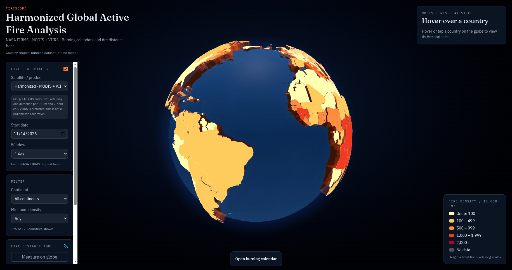
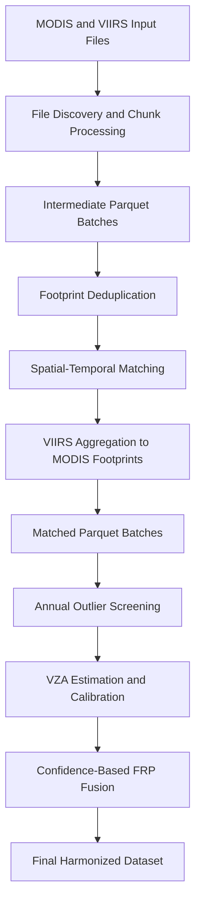
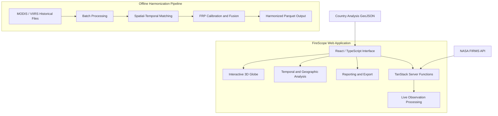

# FireScope

**FireScope** is an interactive geospatial application for exploring, analyzing, and visualizing global active-fire activity using satellite observations from MODIS and VIIRS.

It combines an interactive 3D globe, historical fire-activity analysis, country-level indicators, and satellite-derived observations from NASA's Fire Information for Resource Management System (FIRMS). It also includes a MODIS–VIIRS harmonization project to support cross-sensor fire-data analysis.

## Features

- **Interactive 3D Globe** — Explore global fire activity through an interactive globe with country selection, geographic filtering, and fire-density visualization.
- **Satellite Fire Monitoring** — Retrieve and visualize active-fire observations from MODIS, Suomi NPP, NOAA-20, and NOAA-21 through NASA FIRMS.
- **Burning Activity Calendar** — Explore monthly and seasonal fire-activity patterns across country, continent, and global geographic scopes.
- **Historical Comparison** — Compare fire-pixel counts across different years and selected months.
- **Sensor Comparison** — Switch between MODIS and individual VIIRS satellite platforms to examine their observations independently.
- **FRP Exploration** — Investigate Fire Radiative Power (FRP) measurements associated with individual active-fire detections.
- **Proximity Analysis** — Measure geographic distances and count nearby fire detections within a configurable buffer.
- **Data Reporting** — Export supported analysis results to CSV and generate print-oriented reports.
- **MODIS–VIIRS Harmonization** — Combine satellite observations for visualization and provide a separate batch-based scientific FRP harmonization pipeline.

## Scientific Scope

FireScope focuses on the spatial and temporal exploration of satellite-observed active-fire signals.

An active-fire detection represents a satellite observation flagged by an instrument's active-fire detection algorithm. It does not necessarily represent an individual fire, a complete burned area, a fire perimeter, or the full duration of a fire event.

The application is intended for exploratory analysis, research communication, and geospatial visualization. It is not a validated operational fire-warning system and should not replace ground observations or specialist fire-monitoring products.

## Data Sources

### NASA FIRMS

FireScope retrieves active-fire observations through the official NASA Fire Information for Resource Management System (FIRMS) Area API.

Supported satellite platforms include:

| Sensor family | Satellite platforms |
|---|---|
| MODIS | Terra, Aqua |
| VIIRS | Suomi NPP, NOAA-20, NOAA-21 |

For each requested date, FireScope prefers the science-quality archive product when available and falls back to the corresponding Near Real-Time (NRT) product when necessary.

Official source: [NASA FIRMS](https://firms.modaps.eosdis.nasa.gov/)

### Country-Level Analysis Dataset

FireScope also includes a precomputed country-level dataset:

`public/data/firms_country_analysis.geojson`

The dataset contains country and territory geometries alongside indicators such as total fire pixels, fire density, peak burning month, season duration, and FRP statistics.

These indicators are supplied as a bundled dataset. They are not recalculated from the currently selected live FIRMS query and should be interpreted independently of the live observation layer.

## MODIS–VIIRS Harmonization

MODIS and VIIRS have different sensor characteristics, spatial resolutions, observation systems, and detection capabilities. Combining their observations therefore requires care.

FireScope includes two complementary approaches to handling observations from these sensors.

### 1. Web Application: Spatial-Temporal De-duplication

The web application uses a deterministic de-duplication heuristic when the user selects the combined Harmonized observation view.

Its purpose is to reduce potentially overlapping detections in the combined visualization. It is not a radiometric calibration procedure or a scientifically validated fire-event matching algorithm.

The procedure consists of five steps:

1. **Field normalization:** Map MODIS and VIIRS records into a common observation structure.
2. **Spatial-temporal grouping:** Assign observations to comparison cells using acquisition date, two-hour UTC time bins, and coordinates rounded to two decimal places.
3. **Potential duplicate identification:** Treat observations sharing the same comparison key as potential duplicates.
4. **Record selection:** Prefer VIIRS over MODIS when both sensor families compete. Within the same sensor family, retain the observation with the higher FRP.
5. **Source preservation:** Keep individual sensor and satellite views available so users can inspect the original observations independently.

This method is intended for visualization-level duplicate reduction. It may merge nearby but distinct detections or fail to identify observations representing the same fire event.

### 2. Offline Pipeline: Scientific FRP Harmonization

A separate batch-based processing pipeline performs a more detailed MODIS–VIIRS harmonization procedure.

Unlike the web application's de-duplication heuristic, this pipeline focuses on making VIIRS and MODIS Fire Radiative Power (FRP) measurements more comparable.

**Features considered for harmonization**

| Feature | Treatment |
|---|---|
| Fire Radiative Power (FRP) | VIIRS FRP is spatially aggregated to MODIS footprints, followed by empirical calibration and quality-based fusion. |
| Brightness temperature | Sensor-specific brightness channels are retained. VIIRS brightness temperatures are aggregated within MODIS footprints, but are not directly calibrated to MODIS brightness. |

**Main processing steps**

1. **Data preparation:** Load MODIS and VIIRS observations and standardize the required fields and acquisition times.
2. **Footprint preparation:** Estimate observation footprint geometry using scan and track dimensions.
3. **Duplicate removal:** Remove overlapping observations within each sensor to reduce redundant detections.
4. **Spatial-temporal matching:** Match VIIRS footprints to MODIS reference footprints using spatial containment and a maximum temporal difference.
5. **VIIRS aggregation:** Sum the FRP of matched VIIRS detections within each MODIS footprint.
6. **Outlier screening:** Screen extreme VIIRS-to-MODIS FRP ratios using an interquartile-range rule.
7. **VZA calibration:** Estimate MODIS viewing zenith angle (VZA) and fit an empirical relationship between VZA and the VIIRS-to-MODIS FRP ratio.
8. **FRP fusion:** Select the final FRP measurement using the relative confidence of the MODIS observation and its contributing VIIRS observations.

**Batch processing architecture**

The offline pipeline uses intermediate Parquet batches to process large satellite datasets without requiring all observations to remain in memory simultaneously.

Batch processing separates data preparation, matching, and calibration into manageable stages. It also allows intermediate results to be stored and reused, reducing memory pressure when processing large yearly datasets.

**Desired output**

The offline pipeline produces a matched dataset in which each output record represents a MODIS reference footprint and contains the associated VIIRS measurements and harmonization results.

The output includes:

- MODIS reference footprint and acquisition information.
- Aggregated VIIRS FRP and brightness-temperature measurements.
- MODIS viewing zenith angle and calibration information.
- Original and adjusted FRP measurements.
- Final fused FRP and selected sensor source.
- Confidence information and matching statistics.

The resulting dataset is intended for further analysis of cross-sensor FRP consistency and combined fire observations.

For the complete scientific methodology, assumptions, equations, processing details, and limitations, see:

- [`docs/harmonization.md`](./docs/harmonization.md) — Detailed scientific methodology and harmonization workflow.
- [`harmonization/README.md`](./harmonization/README.md) — Implementation details, computation design, and solutions to processing challenges.

## Architecture

FireScope combines a browser-based geospatial application with server-side satellite data retrieval and a separate offline harmonization pipeline.

The two pathways have different responsibilities:

- The web application retrieves observations for interactive exploration and applies its lightweight de-duplication procedure when the combined sensor view is requested.
- The offline pipeline processes historical datasets in batches and applies the more detailed FRP harmonization methodology.

The offline pipeline is not the same processing operation used by the live web application.

## Technical Stack

| Technology | Purpose |
|---|---|
| React and TypeScript | User interface and application logic |
| TanStack Start | Full-stack application framework and server functions |
| TanStack Router | Application routing |
| Vite | Development and production build tooling |
| globe.gl and Three.js | Interactive 3D globe rendering |
| D3 Geo | Geographic calculations and spatial operations |
| GeoJSON | Country geometries and country-level indicators |
| Zod | Server-function input validation |
| NASA FIRMS API | Satellite active-fire observations |
| Python | Offline satellite-data harmonization |
| Pandas and Parquet | Tabular processing and intermediate batch storage |

## Data Limitations and Interpretation

Several limitations should be considered when using FireScope:

- **Active-fire detections:** A detection is not equivalent to an individual fire or burned area.
- **Cloud contamination:** Clouds and other atmospheric conditions can affect the detection of active fires.
- **Cross-sensor differences:** MODIS and VIIRS differ in spatial resolution, spectral characteristics, and detection capabilities.
- **Web de-duplication:** The combined visualization uses approximate spatial-temporal grouping rather than definitive event identification.
- **Country indicators:** The bundled country dataset does not currently include a complete provenance manifest or documented temporal coverage.
- **Temporal sampling:** Country, continent, and world burning calendars use different sampling strategies. Some regional results are samples rather than complete monthly or annual totals.
- **Display limits:** The globe limits plotted observations to 60,000 per request. The number of displayed points may therefore be lower than the source response total.
- **Offline calibration:** The scientific harmonization pipeline uses empirical calibration and depends on its matching assumptions, available observations, and calibration population.

For reproducible research, record the query date, satellite product, requested date range, geographic scope, selected platforms, harmonization setting, and temporal sampling method.

Important findings should be checked against original NASA product documentation, ground observations, and relevant ancillary datasets before being used for operational or scientific conclusions.

## Future Work

Planned improvements include:

- **Improve harmonization performance:** Optimize batch processing, reduce unnecessary data loading, and improve the speed of spatial-temporal matching.
- **Improve cloud-contamination handling:** Incorporate cloud-related information and quality factors to improve the reliability of VIIRS FRP measurements and their comparison with MODIS.
- **Improve footprint matching:** Explore more accurate sensor-footprint geometry and spatial-overlap methods.
- **Improve calibration robustness:** Investigate additional calibration models and validation strategies across different viewing angles, regions, and observation conditions.
- **Improve data provenance:** Document the sources, temporal coverage, processing methods, and versions of the bundled country-level indicators.
- **Expand analytical capabilities:** Add further temporal, geographic, and cross-sensor analysis tools.

## Acknowledgements

FireScope uses satellite active-fire observations provided by NASA's Fire Information for Resource Management System (FIRMS).

We acknowledge the MODIS and VIIRS satellite observation programs for providing the data that support the application's fire-monitoring and harmonization capabilities.
